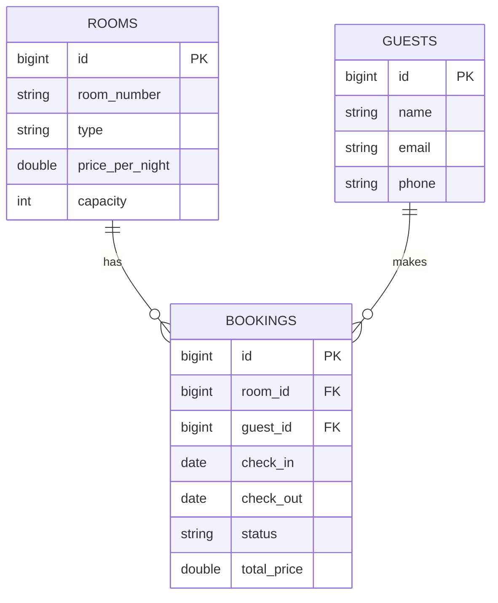

# Hotel Reservation System

A REST API for managing hotel rooms, guests, and bookings, built with Java and Spring Boot.

> **Status: In Progress.** The design (schema, endpoints, business rules) is complete. Implementation is under way. See [Status](#status).

## Tech Stack

- Java 21
- Spring Boot 4.1.x (Spring Web, Spring Data JPA, Validation)
- Hibernate (JPA implementation)
- H2 in-memory database for development, MySQL as the target database
- Maven (via the included `./mvnw` wrapper)

## Status

- [x] Project scaffolded with Spring Initializr
- [x] Database schema and API designed (this document)
- [x] Room CRUD
- [x] Guest CRUD
- [x] Booking creation with overlap check
- [x] Booking cancellation
- [x] Available-room search
- [ ] Global exception handling (consistent error responses)
- [ ] Switch from H2 to MySQL
- [ ] Unit and integration tests
- [ ] API documentation (Swagger UI)

## Architecture

The application is split into three layers. Each layer talks only to the layer below it.

```
Client (browser / curl / Swagger UI)
   │   HTTP request: method + URL + JSON body
   ▼
Controller   - receives the request, validates input, returns the response
   ▼
Service      - business rules (availability, pricing, status changes)
   ▼
Repository   - Spring Data JPA / Hibernate generates the SQL
   ▼
Database     - rooms, guests, bookings
```

Spring's dependency injection creates the controller, service, and repository objects (beans) at startup and passes each one to the class that needs it through its constructor.

## Database Schema

### Tables

**rooms**

| Column | Type | Notes |
|---|---|---|
| id | BIGINT | Primary key, auto-generated |
| room_number | VARCHAR | Unique, required |
| type | VARCHAR | SINGLE, DOUBLE, SUITE |
| price_per_night | DOUBLE | Must be positive |
| capacity | INT | At least 1 |

**guests**

| Column | Type | Notes |
|---|---|---|
| id | BIGINT | Primary key, auto-generated |
| name | VARCHAR | Required |
| email | VARCHAR | Unique, required |
| phone | VARCHAR | Optional |

**bookings**

| Column | Type | Notes |
|---|---|---|
| id | BIGINT | Primary key, auto-generated |
| room_id | BIGINT | Foreign key to rooms(id) |
| guest_id | BIGINT | Foreign key to guests(id) |
| check_in | DATE | Required |
| check_out | DATE | Required, must be after check_in |
| status | VARCHAR | CONFIRMED or CANCELLED |
| total_price | DOUBLE | nights x room price, calculated by the service |

### Relationships

- One room has many bookings.
- One guest has many bookings.
- Each booking belongs to exactly one room and one guest.



## API Endpoints

| Method | URL | Description | Success |
|---|---|---|---|
| GET | `/api/rooms` | List all rooms | 200 |
| GET | `/api/rooms/{id}` | Get one room | 200 |
| POST | `/api/rooms` | Create a room | 201 |
| PUT | `/api/rooms/{id}` | Update a room | 200 |
| DELETE | `/api/rooms/{id}` | Delete a room | 204 |
| GET | `/api/rooms/available?checkIn=&checkOut=` | Rooms free for a date range | 200 |
| GET | `/api/guests` | List all guests | 200 |
| GET | `/api/guests/{id}` | Get one guest | 200 |
| POST | `/api/guests` | Register a guest | 201 |
| PUT | `/api/guests/{id}` | Update a guest | 200 |
| DELETE | `/api/guests/{id}` | Delete a guest | 204 |
| GET | `/api/bookings` | List all bookings | 200 |
| GET | `/api/bookings/{id}` | Get one booking | 200 |
| POST | `/api/bookings` | Create a booking (runs the overlap check) | 201 |
| PUT | `/api/bookings/{id}/cancel` | Cancel a booking | 200 |

### Error responses

| Status | Meaning | Example cause |
|---|---|---|
| 400 Bad Request | Input failed validation | Missing field, check-out before check-in |
| 404 Not Found | Resource does not exist | Unknown room, guest, or booking id |
| 409 Conflict | Business rule violated | Room already booked for those dates, booking already cancelled |

## Business Rules

1. A booking must reference an existing guest and an existing room.
2. Check-in cannot be in the past, and check-out must be after check-in.
3. Two confirmed bookings on the same room cannot overlap. A new booking conflicts with an existing one when:

```
   existing.check_in < new.check_out  AND  existing.check_out > new.check_in
```

   A booking that checks in on the same day another one checks out is allowed.
4. `total_price = number of nights x room.price_per_night`.
5. Cancelling sets `status = CANCELLED` and keeps the row for history. Cancelled bookings are ignored by the overlap check, so the room becomes available again.
6. Room numbers and guest emails must be unique.

## Request Walkthroughs

### 1. Create a booking

Request:

```
POST /api/bookings
Content-Type: application/json

{ "guestId": 3, "roomId": 1, "checkIn": "2026-11-10", "checkOut": "2026-11-13" }
```

URL breakdown: `http://localhost:8080` is the host and port, `/api/bookings` is the resource, and `POST` is the action (create). The data for creating something travels in the JSON body.

Flow:

1. **Controller** (`BookingController`, `@PostMapping`): converts the JSON into a `BookingRequest` DTO, validates it with `@Valid`, and calls `bookingService.create(request)`.
2. **Service** (`BookingService.create`):
   1. Load the guest by id, or fail with 404.
   2. Load the room by id, or fail with 404.
   3. Check the dates (rule 2).
   4. Run the overlap check. If there is a conflict, fail with 409.
   5. Calculate `total_price` (3 nights x 2500 = 7500).
   6. Save a booking with status `CONFIRMED`.
3. **Repository**: runs the queries below.

| Step | Table | Operation |
|---|---|---|
| Find guest | guests | SELECT by id |
| Find room | rooms | SELECT by id (reads price_per_night) |
| Overlap check | bookings | SELECT on room_id, status, check_in, check_out |
| Save | bookings | INSERT (room_id, guest_id, check_in, check_out, status, total_price) |

Response: `201 Created` with the new booking as JSON, including its generated `id`.

### 2. Dates overlap an existing booking

Same request, but room 1 is already booked for part of that range. The overlap check returns true, the service throws an exception, and nothing is inserted. The client receives `409 Conflict` with a message such as "Room 1 is not available for those dates".

### 3. Invalid input

A missing `checkIn`, or a `checkOut` before `checkIn`, is rejected by validation in the controller. The service never runs. Response: `400 Bad Request` with the field errors.

### 4. Search available rooms

```
GET /api/rooms/available?checkIn=2026-11-10&checkOut=2026-11-13
```

The dates are query parameters because this is a filter on a read. The service returns rooms that have no confirmed booking overlapping the range. This is a read-only operation, so no table changes. Response: `200 OK` with a JSON list of rooms.

### 5. Cancel a booking

```
PUT /api/bookings/5/cancel
```

The `5` is a path variable identifying one booking. The service loads the booking (404 if missing), rejects it if already cancelled (409), sets `status = CANCELLED`, and saves. This is an UPDATE of one column on one row. Response: `200 OK` with the updated booking.

### 6. Register a guest and manage rooms

`POST /api/guests` runs through the same chain: controller, `GuestService` (checks the email is not already used), INSERT into `guests`, then `201`. Room management (`/api/rooms`) follows the same pattern for the admin side.

### How changes reach a frontend

This is a REST API. It never pushes updates. The client sends a request, the server sends one response, and the client's code uses the JSON to update the screen (for example, showing a confirmation, or re-calling `GET /api/bookings` to refresh a list). If another user books a room, a client sees it on its next request.

## Project Structure

```
hotel-reservation-system/
├── pom.xml                                  dependencies and build config
├── mvnw                                     Maven wrapper
└── src/main/
    ├── java/com/kushagra/hotel/
    │   ├── HotelReservationSystemApplication.java    entry point
    │   ├── room/        Room, RoomRepository, RoomService, RoomController
    │   ├── guest/       Guest, GuestRepository, GuestService, GuestController
    │   └── booking/     Booking, BookingRequest, BookingRepository,
    │                    BookingService, BookingController
    └── resources/application.properties     settings
```

## Running Locally

Requirements: JDK 21.

```bash
git clone git@github.com:KG-Builds/hotel-reservation-system.git
cd hotel-reservation-system
./mvnw spring-boot:run
```

The API starts on `http://localhost:8080`. By default it uses an in-memory H2 database, so data resets on every restart. The H2 console is available at `/h2-console` while developing.

Try it with curl:

```bash
curl -X POST localhost:8080/api/rooms -H "Content-Type: application/json" \
  -d '{"roomNumber":"101","type":"SINGLE","pricePerNight":2500,"capacity":1}'
curl localhost:8080/api/rooms
```

## Roadmap

1. Complete Room, Guest, and Booking CRUD with the overlap check
2. Global exception handler returning consistent JSON errors
3. Move from H2 to MySQL
4. Unit tests (JUnit, Mockito) for the service layer and integration tests for the API
5. Swagger UI documentation
6. Authentication (later)

## Author

Kushagra Garg, MCA, University of Delhi
